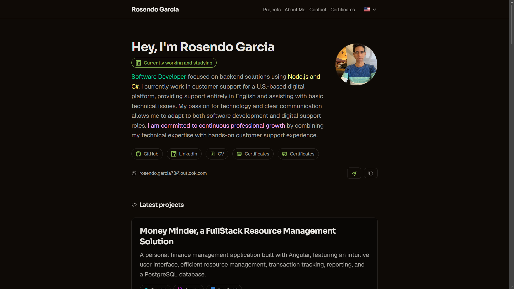
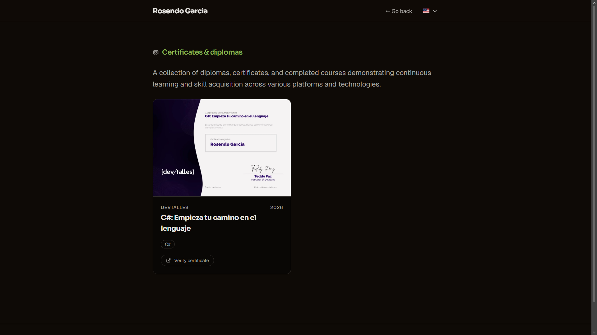

# Rosendo Garcia · Portfolio

Personal portfolio showcasing my projects, skills, work experience, and certificates.

**Live site:** https://rosendo-garcia.vercel.app



## Stack

[Astro](https://astro.build) · TypeScript · Tailwind CSS · Deployed on Vercel

## Features

- Bilingual (English / Spanish) with Astro's built-in i18n routing
- Projects, skills, work experience, and about sections
- Dedicated certificates page
- Contact form
- Responsive layout



## Run locally

Requires Node.js and [pnpm](https://pnpm.io).

```bash
git clone https://github.com/Roosendo/<repo-name>.git
cd <repo-name>
pnpm install
pnpm dev
```

The site runs at `http://localhost:4321`.

## Scripts

| Command          | Description                      |
| ---------------- | -------------------------------- |
| `pnpm dev`       | Start the dev server             |
| `pnpm build`     | Build for production             |
| `pnpm preview`   | Preview the production build     |
| `pnpm lint`      | Lint with oxlint                 |
| `pnpm lint:fix`  | Lint and auto-fix                |
| `pnpm fmt`       | Format with oxfmt                |
| `pnpm fmt:check` | Check formatting without writing |

## Code quality

- **Lint and format:** oxlint and oxfmt
- **Git hooks:** Lefthook runs lint and format on staged files before each commit
- **Commit messages:** validated with commitlint ([Conventional Commits](https://www.conventionalcommits.org)), see [CONTRIBUTING.md](./CONTRIBUTING.md)
- **CI:** GitHub Actions runs lint, format check, and build on every push and pull request

## Contact

- Email: rosendo.garcia73@outlook.com
- [LinkedIn](https://www.linkedin.com/in/rosendoo-garcia)
- [GitHub](https://github.com/Roosendo)

[See License](./LICENSE.md) for license information.
